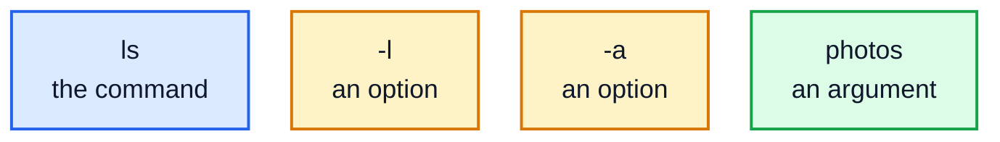

# 1. The terminal

Before windows and mice, people used computers by typing commands, and the computer typed back. That way of working never went away. Servers, cloud machines, and most of the tools developers use every day are controlled by typing commands, because commands are fast, precise, and easy to repeat or automate. This lesson gets you started.

## Terminal, shell, command line

A few words get mixed up, so here's what each one means:

- The **terminal** is the window you type into.
- The **shell** is the program inside it that reads your commands and runs them. The most common shells are **Bash** and **Zsh** (the default on macOS). Everything in this course works in both.
- The **command line** is the line you type on, and more generally this whole way of working.

**Linux** is the operating system that runs most of the world's servers, cloud machines and Android phones. macOS works in a very similar way, because both follow the same older design, called Unix.

## Opening a terminal

- **Linux**: open the "Terminal" app, often with Ctrl+Alt+T.
- **macOS**: open Terminal, from Applications, then Utilities.
- **Windows**: install **WSL** (Windows Subsystem for Linux), which gives you a real Ubuntu Linux inside Windows. Open PowerShell as administrator, run `wsl --install`, restart, and open "Ubuntu" from the Start menu. (Git Bash, which comes with Git for Windows, also works for most of this course, but not all of it.)

You'll see a **prompt**: a short line that ends with `$`, and a blinking cursor. It often shows your username, the computer's name and the folder you're in, something like `alex@laptop:~$`. In this course, commands are shown after a `$`. Don't type the `$`.

## Your first commands

Type a command and press Enter. The shell runs it and shows what it prints, called its **output**:

```
$ echo Hello, terminal
Hello, terminal
$ whoami
alex
$ pwd
/home/alex
$ date
Mon Oct 26 05:01:59 AM UTC 2026
$ uname
Linux
```

- `echo` prints whatever you give it.
- `whoami` prints your username. (Yours will be different from these examples.)
- `pwd` ("print working directory") shows which folder you're in. When you open a terminal, you start in your **home folder**, which on Linux is `/home/` followed by your username, and on a Mac is `/Users/` followed by your username.
- `date` shows the date and time.
- `uname` shows the name of the operating system's core, called the **kernel**: `Linux`, or `Darwin` on a Mac.

If you mistype a command, the shell tells you:

```
$ datee
bash: datee: command not found
```

Commands are **case-sensitive**: `Date` and `date` are different, and only `date` exists.

## The shape of a command

Most commands follow the same pattern: the **command**, then **options** that change how it behaves, then **arguments** saying what to work on, all separated by spaces:



`ls` lists what's in a folder. On its own, it lists the current folder. Options usually start with `-`:

```
$ ls
notes.txt
photos
$ ls -l
total 4
-rw-rw-r-- 1 alex alex  4 Oct 26 01:01 notes.txt
drwxrwxr-x 2 alex alex 40 Oct 26 01:01 photos
```

`-l` means the **long** format: permissions (lesson 5), owner, size in bytes, date modified, and name. A `d` at the very start means it's a directory (folder). Options can be combined: `ls -l -a` and `ls -la` mean the same. Many options also have a long form with two dashes, like `--all` for `-a`.

## Getting help

Nobody remembers every option. There are three good ways to look them up:

- `ls --help` prints a summary of a command's options (on Linux; most macOS commands don't have it).
- `man ls` opens the full **manual page**. Move with the arrow keys or Space, search by typing `/` then a word and Enter, and press `q` to quit.
- Search the web for "linux ls examples". There's no shame in it: experienced people do it all the time.

```
$ ls --help | head -3
Usage: ls [OPTION]... [FILE]...
List information about the FILEs (the current directory by default).
Sort entries alphabetically if none of -cftuvSUX nor --sort is specified.
```

(`| head -3` shows just the first 3 lines. Lesson 4 explains the `|`.)

In help text, square brackets like `[OPTION]` mean "optional", and `...` means "you can give more than one".

## Keys that save time

| Key | Does |
|---|---|
| **Tab** | finishes a command or file name for you. Press it twice to see the choices. Use it constantly: it saves typing and avoids typos. |
| **Up arrow** | brings back your previous commands, so you can run them again or change them |
| **Ctrl+C** | stops the command that's running |
| **Ctrl+L**, or `clear` | clears the screen |
| **Ctrl+A**, **Ctrl+E** | jump to the start or end of the line |
| `history` | lists the commands you've typed |

On macOS, Ctrl is still Ctrl in the terminal, not Cmd.

## Practice

The practice for each lesson happens in a folder of its own under `~/practice/linux-command-line/` in your home folder, so nothing you do can affect the course files or anything else. Each lesson's `practice` folder has two scripts:

- `setup.sh` makes the practice folder, with the files you'll need.
- `check.sh` checks your work and tells you what's right and what's wrong.

From the folder where you downloaded this course, run:

```bash
bash 01-the-terminal/practice/setup.sh
```

It prints where to go next. In the practice folder there's a file called `welcome.txt` and a file called `answers.txt` that looks like this:

```
1: 
2: 
3: 
4: 
5: 
```

Find each answer by running a command, and type it after the number. Open `answers.txt` in any text editor (on Linux, `nano answers.txt` works in the terminal; lesson 9 covers editors properly).

1. Your username.
2. The full path of the practice folder (run the command inside it).
3. The number of lines in `welcome.txt`. The command `wc -l welcome.txt` counts them.
4. The name of the kernel your computer runs.
5. Which option makes `ls -l` show sizes like `4.0K` instead of `4096`? Look in `ls --help` or `man ls` for "human-readable".

Then check:

```bash
bash ~/path/to/the/course/01-the-terminal/practice/check.sh
```

(`setup.sh` prints the exact command for you.) To start again with fresh files, run `setup.sh` again.

<details>
<summary>Hints</summary>

- The commands are `whoami`, `pwd`, `wc -l welcome.txt` and `uname`. Copy only the answer: for `wc`, that's the number, not the file name after it.
- For question 5, try `ls --help | grep -i human`. On a Mac, run `man ls`, type `/human` and press Enter.

</details>

The answers are in [solutions/01-the-terminal.md](../solutions/01-the-terminal.md).

## Recap

- The shell runs the commands you type in the terminal. Commands are case-sensitive.
- A command is followed by options (starting with `-`) and arguments, separated by spaces.
- `--help` and `man` explain any command. Tab completes names; the up arrow repeats commands; Ctrl+C stops one.
- `pwd` shows where you are, `ls` lists files, `whoami` shows who you are.

Next: [2. Files and directories](../02-files-and-directories/)
