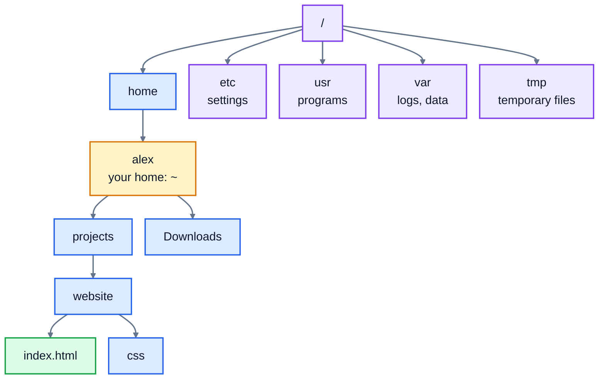

# 2. Files and directories

Everything on a Linux system lives in one big tree of folders, which the command line calls **directories**. This lesson is about moving around that tree and organising files in it: making folders, copying, moving, renaming and deleting. These are the commands you'll use more than any others.

## The tree

Linux has one top-level directory, called the **root** and written `/`. Everything else is inside it:



A few of the system directories you'll meet: `/etc` holds settings files, `/usr` holds installed programs, `/var/log` holds log files, and `/tmp` holds temporary files that are cleared out regularly. Your own files go in your **home directory**, `/home/alex` if your username is `alex` (`/Users/alex` on a Mac).

There are no drive letters like `C:`. A USB stick or a second disk appears as a directory somewhere in the tree, such as `/media/alex/USB`.

## Paths

A **path** says where a file is. There are two kinds:

- An **absolute** path starts at the root, with `/`: `/home/alex/projects/website/index.html`. It means the same thing wherever you are.
- A **relative** path starts from the directory you're in now: if you're in `/home/alex/projects`, then `website/index.html` means the same file.

Some shortcuts:

| Shortcut | Means |
|---|---|
| `~` | your home directory |
| `.` | the current directory |
| `..` | the directory above this one (the parent) |
| `-` | (with `cd`) the directory you were in before |

## Moving around: pwd, ls, cd

```
$ pwd
/home/alex/projects/website/css
$ cd ../..
$ pwd
/home/alex/projects
```

- `pwd` shows where you are.
- `cd directory` moves you there. `cd ..` goes up one level; `cd ../..` goes up two. `cd` on its own, or `cd ~`, takes you home.
- `ls` lists what's here. `ls -l` shows details, `ls -a` also shows **hidden files** (names starting with `.`, like `.bashrc`), and `ls -R` lists folders inside folders too.

Press Tab while typing a path, and the shell completes it. Use this all the time.

## Making things: mkdir and touch

```
$ mkdir website/css
mkdir: cannot create directory ‘website/css’: No such file or directory
$ mkdir -p website/css
$ touch website/index.html website/css/style.css
$ ls -R website
website:
css
index.html

website/css:
style.css
```

- `mkdir name` makes a directory. It fails if the directory it goes in doesn't exist yet. `mkdir -p` makes every missing directory along the path, and doesn't complain if they already exist.
- `touch file` creates an empty file (or, if it exists, updates its modified time).

Most commands accept several arguments at once, like the two files given to `touch` above.

## Copying, moving and renaming: cp and mv

```
$ cp website/index.html website/about.html
$ mv website/about.html website/team.html
$ ls website
css
index.html
team.html
```

- `cp source destination` copies a file. To copy a directory and everything in it, add `-r` (recursive): `cp -r website website-backup`.
- `mv source destination` moves a file. There's no separate rename command: renaming is moving to a new name in the same place.
- If the destination is an existing directory, the file goes inside it, keeping its name: `mv notes.txt documents/`.

**Careful**: if the destination is an existing **file**, `cp` and `mv` replace it without asking. Add `-i` (interactive) to be asked first.

## Deleting: rm and rmdir

```
$ rm website
rm: cannot remove 'website': Is a directory
$ rmdir website
rmdir: failed to remove 'website': Directory not empty
```

- `rm file` deletes a file.
- `rmdir directory` deletes a directory, but only if it's empty, which makes it a safe choice.
- `rm -r directory` deletes a directory and **everything inside it**.

There is **no recycle bin** on the command line. A deleted file is gone. Be especially careful with `rm -r`, and with wildcards (below): check what a pattern matches with `ls` first, then change `ls` to `rm`. Adding `-i` makes `rm` ask about each file.

## Wildcards

The shell can fill in file names for you, using patterns called **globs**:

| Pattern | Matches |
|---|---|
| `*` | any characters (including none) |
| `?` | exactly one character |
| `[abc]` | one of those characters |

So `*.jpg` means "every name ending in .jpg", and `invoice-*.pdf` means "every name starting with invoice- and ending in .pdf".

```
$ ls website/*.html
website/index.html
website/team.html
```

The **shell** expands the pattern into the matching names before the command even runs, so this works with any command: `mv *.jpg photos/` becomes `mv beach-1.jpg beach-2.jpg ... photos/`. If nothing matches, the pattern is passed on unchanged, and you get an error like `ls: cannot access '*.html': No such file or directory`.

## Names with spaces

The shell splits a command at spaces, so a file name with a space in it is read as two names:

```
$ ls budget 2026.csv
ls: cannot access 'budget': No such file or directory
ls: cannot access '2026.csv': No such file or directory
$ ls "budget 2026.csv"
budget 2026.csv
```

Put quotes around the name, or put a backslash before the space: `budget\ 2026.csv`. Tab completion adds the backslashes for you. Many people avoid spaces in file names altogether, and use `-` or `_` instead.

## Practice: tidy up a downloads folder

Run the setup script, from the course folder:

```bash
bash 02-files-and-directories/practice/setup.sh
```

It makes a messy `downloads` folder. Go there, have a look with `ls -la`, and then:

1. Make a folder called `photos`, and move all four `.jpg` files into it.
2. Make `documents/invoices` and `documents/notes` (`documents` doesn't exist yet). Move the two `invoice-` files into `documents/invoices`, and `todo.txt` and `notes.txt` into `documents/notes`.
3. Rename `budget 2026.csv` to `budget-2026.csv`.
4. Delete `report (copy).txt`, but keep `report.txt`.
5. Delete the empty folder `old-stuff`.
6. Make a complete copy of `documents`, called `documents-backup`.
7. Leave the hidden `.settings` file where it is.

Then run `check.sh`, as `setup.sh` showed you. If you get in a muddle, run `setup.sh` again to start over.

<details>
<summary>Hints</summary>

- Step 1: `mkdir photos`, then `mv *.jpg photos/`.
- Step 2: `mkdir -p` can make several paths at once: `mkdir -p documents/invoices documents/notes`.
- Steps 3 and 4: use quotes round names with spaces or brackets.
- Step 6: `cp -r`.

</details>

The answers are in [solutions/02-files-and-directories.md](../solutions/02-files-and-directories.md).

## Recap

- One tree, starting at `/`. Your files are under your home directory, `~`.
- Absolute paths start with `/`; relative paths start from where you are. `.` is here, `..` is up one.
- `cd`, `ls`, `pwd` to move and look; `mkdir -p`, `touch` to create; `cp -r`, `mv` to copy and move; `rm`, `rmdir`, `rm -r` to delete.
- `*` matches any characters in names. Quote names with spaces. There's no undo for `rm`.

Next: [3. Viewing and searching](../03-viewing-and-searching/)
