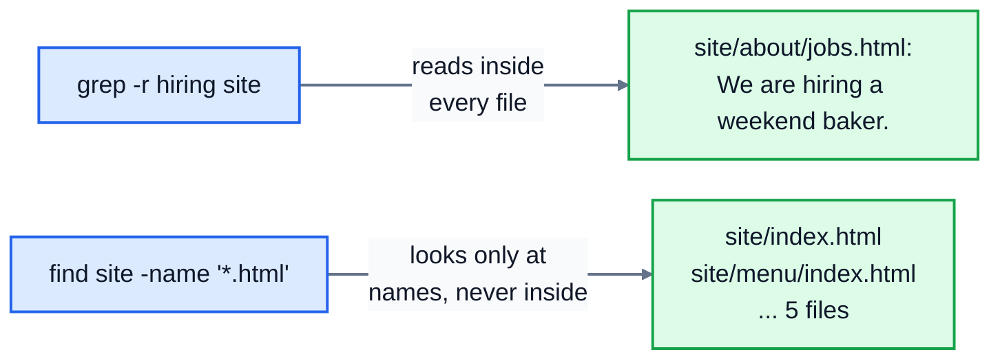

# 3. Viewing and searching

On a server, there's often no desktop and no file browser: just a terminal. When a website misbehaves, the clues are in text files, mostly logs, which can be hundreds of thousands of lines long. This lesson covers the commands for reading files and finding what you need in them, fast.

The examples use a copy of a small bakery's web server: its pages in `site/`, and its logs in `logs/`.

## Reading files

### cat: print the whole file

```
$ cat site/menu/specials.html
<h1>This week</h1>
<p>New: a gluten-free seeded loaf, Fridays only.</p>
```

`cat` prints everything at once, which is perfect for short files and useless for long ones: a log of 300,000 lines just scrolls past. (The name comes from "concatenate", because `cat a.txt b.txt` prints both files one after the other.)

### less: scroll through a long file

`less logs/access.log` opens the file in a viewer you can move around in:

| Key | Does |
|---|---|
| Space, or Page Down | next screen |
| `b`, or Page Up | previous screen |
| arrow keys | one line at a time |
| `g`, `G` | jump to the start, or the end |
| `/word`, then Enter | search forward for "word"; `n` for the next match |
| `q` | quit |

`less` doesn't load the whole file at once, so it opens huge files instantly. (Its name is a joke: it replaced an older viewer called `more`.) `man` pages open in `less` too, which is why the keys are the same.

### head and tail: the start and the end

```
$ head -n 3 logs/error.log
2026-03-14 08:12:40 [warn] slow response from payments service (2.8s)
2026-03-14 09:03:11 [error] /order/confirm: payments service TIMEOUT after 5s
2026-03-14 09:47:52 [info] cache cleared
$ tail -n 2 logs/error.log
2026-03-14 11:20:02 [warn] disk 81% full on /var
2026-03-14 11:41:09 [warn] 25 failed requests to /wp-login.php from 192.0.2.44
```

Without `-n`, both show 10 lines. Logs are written in time order, so `tail` shows what happened most recently.

`tail -f logs/access.log` ("follow") prints the last lines and then **keeps waiting**, printing each new line as it's written. Leave it running while you reload the website, and you'll see each request arrive. Press Ctrl+C to stop.

### wc: count

```
$ wc logs/error.log
  8  65 526 logs/error.log
$ wc -l logs/access.log
345 logs/access.log
```

`wc` ("word count") prints the number of lines, words and bytes. `-l` gives just the lines, which is what you want most of the time: in a log, it's the number of entries.

## Searching inside files: grep

`grep` prints the lines that contain a pattern:

```
$ grep error logs/error.log
2026-03-14 09:03:11 [error] /order/confirm: payments service TIMEOUT after 5s
2026-03-14 10:15:09 [error] /order/confirm: payments service timeout after 5s
2026-03-14 10:58:31 [error] /order/confirm: database connection refused
```

It's probably the single most useful command for investigating problems. Its options are worth learning:

| Option | Does | Example |
|---|---|---|
| `-i` | ignore case | `grep -i timeout` finds `TIMEOUT` and `timeout` |
| `-n` | show line numbers | |
| `-c` | count the matching lines instead of printing them | `grep -c wp-login logs/access.log` gives `25` |
| `-v` | show lines that **don't** match | `grep -v info` hides the info messages |
| `-r` | search every file in a folder, and the folders inside it | `grep -r hiring site` |
| `-l` | list only the names of files that match | |
| `-w` | match whole words only | `grep -w cat` won't match "category" |

```
$ grep -n -i timeout logs/error.log
2:2026-03-14 09:03:11 [error] /order/confirm: payments service TIMEOUT after 5s
4:2026-03-14 10:15:09 [error] /order/confirm: payments service timeout after 5s
$ grep -r hiring site
site/about/jobs.html:<p>We are hiring a weekend baker.</p>
```

With `-r`, each line starts with the file it came from.

If the pattern has spaces or special characters in it, put it in **single quotes**: `grep '" 404 ' logs/access.log`. The pattern is a **regular expression**, where some characters have special meanings: `.` matches any character, `^` means the start of a line, and `$` the end. So `grep '^2026-03-14 10' logs/error.log` finds lines that start with that date and the 10 o'clock hour. To search for a literal `.` or other special character, use `grep -F`, which treats the pattern as plain text.

## Finding files: find

`grep` searches inside files; `find` searches for the files themselves, by name, type, size or age:

```
$ find site -name '*.html'
site/index.html
site/menu/index.html
site/menu/specials.html
site/about/index.html
site/about/jobs.html
$ find . -type d
.
./site
./site/menu
./site/static
./site/about
./logs
$ find logs -size +20k
logs/access.log
```

- The first argument is where to start looking; `find` then goes through every folder inside it.
- `-name '*.html'`: matching names. Quote the pattern, so `find` gets the `*` rather than the shell. `-iname` ignores case.
- `-type f` for files only, `-type d` for directories only.
- `-size +20k` for files over 20 kilobytes (`+1M` for over a megabyte).
- `-mtime -2` for files modified in the last 2 days.

`find` is how you answer questions like "where did that config file go?" or "what's filling up the disk?".

The difference between the two, side by side:



## Practice: investigate the server

Run the setup script, from the course folder:

```bash
bash 03-viewing-and-searching/practice/setup.sh
```

The practice folder has a `server` folder with `logs` and `site` in it, and an `answers.txt` with seven numbered lines. Use the commands from this lesson to answer:

1. How many requests are in `server/logs/access.log`? (Each line is one request.)
2. How many of those requests got a `404 Not Found` status? In each line, the status comes straight after the closing `"` of the request, like `"GET /favicon.ico HTTP/1.1" 404`.
3. At what time was the first request? Write it as `HH:MM:SS`.
4. Which address made the last request? (The address is the first thing on each line.)
5. Which page under `server/site` mentions "gluten-free"? Give its path.
6. How many `.html` files are there under `server/site`, including the folders inside it?
7. How many lines in `server/logs/error.log` mention a timeout, in upper or lower case?

Write each answer after its number in `answers.txt`, then run `check.sh`, as `setup.sh` showed you.

<details>
<summary>Hints</summary>

- 1: `wc -l`.
- 2: `grep -c '" 404 '`, with the single quotes.
- 3 and 4: `head -n 1` and `tail -n 1`.
- 5: `grep -r gluten-free server/site`. The file name is before the `:`.
- 6: `find server/site -name '*.html'`, then count. Lesson 4 shows how to count automatically with `| wc -l`.
- 7: `grep -i -c timeout server/logs/error.log`.

</details>

The answers are in [solutions/03-viewing-and-searching.md](../solutions/03-viewing-and-searching.md).

## Recap

- `cat` prints a file; `less` lets you scroll and search a long one; `head` and `tail` show the start and end; `tail -f` follows a growing log.
- `wc -l` counts lines.
- `grep pattern file` finds matching lines. Learn `-i`, `-n`, `-c`, `-v`, `-r` and `-l`.
- `find place -name 'pattern'` finds files by name; `-type`, `-size` and `-mtime` narrow it down.

Next: [4. Pipes and redirection](../04-pipes-and-redirection/)
