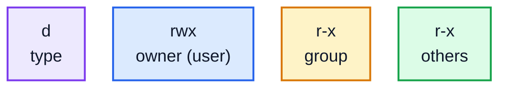

# 5. Permissions

Linux was built for many people sharing one computer, so every file records **who owns it** and **who may do what with it**. Today the "people" are often programs: a web server shouldn't be able to read your SSH keys, and a script you download shouldn't run until you say so. Permissions are how that's enforced. You'll meet them the first time you see `Permission denied`.

## Reading permissions

`ls -l` shows them, in the first column:

```
$ ls -l
total 8
-rw-r--r-- 1 alex alex 189 Oct 26 01:07 deploy.sh
-rw-rw-rw- 1 alex alex  46 Oct 26 01:07 prices-final.csv
drwxrwxr-x 2 alex alex  80 Oct 26 01:07 public
drwxrwxrwx 2 alex alex  60 Oct 26 01:07 secrets
```

The 10 characters at the start of each line break down like this:



- The **type**: `-` for a file, `d` for a directory, `l` for a link.
- Then three sets of three, for three kinds of people:
  - the **owner** (user) of the file, shown in the third column (`alex`)
  - the file's **group**, shown in the fourth column. A group is a named set of users, like everyone in a team.
  - **others**: everyone else
- In each set: `r` read, `w` write, `x` execute, or `-` if that permission is missing.

So `-rw-r--r--` is a file the owner can read and change, and everyone else can only read. `drwxrwxrwx` is a directory anyone can do anything in, which, for a folder called `secrets`, is a problem.

### What r, w and x mean

| | For a file | For a directory |
|---|---|---|
| `r` | read its contents | list the names inside it (`ls`) |
| `w` | change its contents | create, delete and rename files inside it |
| `x` | run it as a program | go into it (`cd`), and reach the files inside it |

Notice that deleting a file depends on the **directory's** `w`, not the file's.

## Permissions as numbers

Each set of three is often written as one digit, by adding up: `r` = 4, `w` = 2, `x` = 1.

| Digits | Letters | Typical use |
|---|---|---|
| `755` | `rwxr-xr-x` | programs and scripts; directories everyone may enter |
| `644` | `rw-r--r--` | ordinary files: you can change them, others can read them |
| `700` | `rwx------` | private directories |
| `600` | `rw-------` | private files: passwords, keys |
| `444` | `r--r--r--` | read-only for everyone, including you |

So `640` is `rw-r-----`: the owner reads and writes (4 + 2), the group reads (4), others get nothing (0).

## Changing permissions: chmod

`chmod` ("change mode") sets permissions, using numbers or letters:

```
$ chmod 600 secrets/api-key.txt
$ chmod +x deploy.sh
$ ls -l deploy.sh
-rwxr-xr-x 1 alex alex 189 Oct 26 01:07 deploy.sh
```

The letter form says **who** (`u` user, `g` group, `o` others, `a` all), then `+` to add, `-` to remove or `=` to set exactly, then which permissions:

| Command | Does |
|---|---|
| `chmod +x deploy.sh` | let it be run |
| `chmod go-w notes.txt` | stop the group and others changing it |
| `chmod u=rw,go= key.txt` | owner reads and writes, nobody else gets anything (`600`) |
| `chmod -R go-rwx private/` | `-R` changes a directory and everything inside it |

Numbers set all the permissions at once; letters change just the ones you mention. Both are common.

### Running a script

A script needs `x` before you can run it by name:

```
$ ./deploy.sh
bash: ./deploy.sh: Permission denied
$ chmod +x deploy.sh
$ ./deploy.sh
Deployed 2 files to live/
```

The `./` means "the file called deploy.sh in this directory". Without it, the shell only looks in the folders listed in `PATH` (lesson 7), and says `command not found`. You can also run a script without `x` by giving it to the shell directly, `bash deploy.sh`, which is what this course does with `setup.sh`.

### When you don't have permission

```
$ chmod 444 prices-final.csv
$ echo 'Bagel,2.50' >> prices-final.csv
bash: prices-final.csv: Permission denied
$ cat /etc/shadow
cat: /etc/shadow: Permission denied
```

`/etc/shadow` holds the password hashes for every account on the computer, so only the system administrator account may read it:

```
$ ls -l /etc/shadow /etc/passwd
-rw-r--r-- 1 root root   3396 Oct 24 06:10 /etc/passwd
-rw-r----- 1 root shadow 1510 Oct 24 06:10 /etc/shadow
```

## root and sudo

The administrator account on Linux is called **root**. Root can read and change anything, whatever the permissions say. Ordinary users get admin powers for a single command with **`sudo`** ("superuser do"):

```bash
sudo apt install tree      # installing software needs root (lesson 10)
```

`sudo` asks for **your** password, and only works if you're allowed to use it (on most personal Linux computers, the first user is). Use it only when a command really needs it. "Permission denied? Just add sudo" is a bad habit: it hides mistakes, and a typo with root powers can damage the whole system.

## Owners and groups

`id` shows who you are and which groups you're in:

```
$ id
uid=1000(alex) gid=1000(alex) groups=1000(alex),27(sudo),100(users)
```

(Shortened.) Being in the `sudo` group is what allows Alex to use `sudo` here. `chown` changes a file's owner and `chgrp` its group; both usually need `sudo`, because you can't give your files away to someone else without admin rights: `sudo chown www-data:www-data /var/www/site`.

### New files: umask

New files don't start with random permissions. The **umask** says which permissions to leave out. Type `umask` to see yours: `0022` gives new files `644` and new directories `755`; `0002` (common on Ubuntu) gives `664` and `775`, so your group can write too. You rarely need to change it.

## Practice: fix a project's permissions

Run the setup script, from the course folder:

```bash
bash 05-permissions/practice/setup.sh
```

It makes a `website` project where the permissions are all wrong. Look with `ls -l`, `ls -l public secrets`, and `ls -ld secrets` (`-d` shows the directory itself instead of what's in it). Then:

1. Make `deploy.sh` runnable: `755`. Then run it with `./deploy.sh`. It copies the public files into a new `live` folder.
2. Make the files in `public` readable by everyone, but changeable only by you: `644`.
3. Make the `secrets` folder private to you: `700`.
4. Make `secrets/api-key.txt` private to you: `600`.
5. Make `prices-final.csv` read-only for everyone, including you: `444`.

Then run `check.sh`, as `setup.sh` showed you.

<details>
<summary>Hints</summary>

- Each step is one `chmod`, with the number given. `chmod 644 public/*` does both public files at once.
- If `./deploy.sh` says `Permission denied`, step 1's `chmod` didn't work: check with `ls -l deploy.sh`.

</details>

The answers are in [solutions/05-permissions.md](../solutions/05-permissions.md).

## Recap

- Each file has an owner, a group, and `rwx` permissions for the owner, the group and others.
- As numbers, r = 4, w = 2, x = 1: `755` for scripts, `644` for ordinary files, `600` and `700` for private ones.
- `chmod` changes permissions. A script needs `x` to run as `./script`.
- On directories, `x` means you can enter them, and `w` means you can add and delete files in them.
- root can do anything; `sudo` runs one command as root. Use it sparingly.

Next: [6. Processes](../06-processes/)
