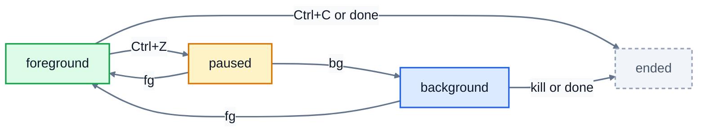

# 6. Processes

Every program that's running is a **process**. Right now your computer is running hundreds: the desktop, the terminal, the shell inside it, background services, and whatever you've just started. This lesson shows how to see them, stop the ones that misbehave, run commands in the background, and tell whether a command worked.

## Seeing processes: ps

```
$ ps aux | head -n 4
USER         PID %CPU %MEM    VSZ   RSS TTY      STAT START   TIME COMMAND
root           1  0.0  0.4  27132 16920 ?        Ss   00:12   0:01 /sbin/init splash
root           2  0.0  0.0      0     0 ?        S    00:12   0:00 [kthreadd]
root           3  0.0  0.0      0     0 ?        S    00:12   0:00 [pool_workqueue_release]
```

`ps aux` lists every process on the computer (`a` all users, `u` with details, `x` including ones not attached to a terminal). The columns that matter most:

| Column | Means |
|---|---|
| `USER` | who it's running as |
| `PID` | the **process ID**: a number that identifies it while it runs |
| `%CPU`, `%MEM` | how much processor time and memory it's using |
| `START`, `TIME` | when it started, and how much CPU time it has used |
| `COMMAND` | the command that started it |

Process 1 is always the first program the system starts, which then starts everything else.

The list is long, so you usually search it with `grep`:

```
$ ps aux | grep bakery-backup
alex       37577  0.0  0.0   7192  3636 ?        S    01:09   0:00 bash ./bakery-backup.sh
alex       37593  0.0  0.0   6568  2464 ?        S    01:09   0:00 /usr/bin/grep bakery-backup
```

The second line is the `grep` itself, because it's also a running command with those words in it. Ignore it. (`pgrep -f bakery-backup` prints just the matching PIDs.)

### top: a live view

`top` shows processes updating every few seconds, busiest first. It's the first thing to run when a computer feels slow. Press `q` to quit. Many people install `htop`, a friendlier version with colours and scrolling.

## Stopping processes: kill and signals

You stop a process by sending it a **signal**, with `kill` and its PID:

```bash
kill 37577
```

Despite the name, `kill` just sends a signal, and the default one, **TERM**, politely asks the program to finish: it can save its work and tidy up first. If it ignores that, **KILL** stops it immediately, with no chance to clean up:

```bash
kill -9 37577        # or: kill -KILL 37577
```

Use `-9` only when a plain `kill` hasn't worked. `kill -l` lists every signal:

```
$ kill -l | head -n 2
 1) SIGHUP	 2) SIGINT	 3) SIGQUIT	 4) SIGILL	 5) SIGTRAP
 6) SIGABRT	 7) SIGBUS	 8) SIGFPE	 9) SIGKILL	10) SIGUSR1
```

| Signal | Number | Sent by | Means |
|---|---|---|---|
| `INT` | 2 | **Ctrl+C** | "interrupt": stop, please |
| `TERM` | 15 | `kill` | "terminate": finish up and exit |
| `KILL` | 9 | `kill -9` | stop now; can't be caught or ignored |
| `HUP` | 1 | closing the terminal | "hang up". Many servers reload their settings when they get it. |
| `STOP` / `TSTP` | 19 / 20 | **Ctrl+Z** | pause |

You can only send signals to your own processes, unless you use `sudo`. `pkill name` and `killall name` send a signal to every process with that name, which is quicker but easier to get wrong.

## Foreground and background

Normally the shell waits for a command to finish before giving you the prompt back: the command runs in the **foreground**. Add `&` to run it in the **background** instead, and get the prompt back straight away:

```
$ sleep 100 &
[1] 37328
$ sleep 200 &
[2] 37329
$ jobs
[1]-  Running                    sleep 100 &
[2]+  Running                    sleep 200 &
```

`[1]` is the **job number** in this shell, and `37328` is the PID. (`sleep 100` does nothing for 100 seconds, which makes it handy for trying things out.)

| You type | Does |
|---|---|
| `command &` | start it in the background |
| `jobs` | list this shell's background jobs |
| `fg %1` | bring job 1 to the foreground |
| **Ctrl+Z** | pause the foreground command |
| `bg %1` | carry on running a paused job, in the background |
| `kill %1` | send TERM to job 1 |

How those keys and commands move a job between states:



Background jobs belong to the terminal: close the terminal and they're stopped too. To keep something running after you log out, start it with `nohup command &`. Long-running services are normally run by the system's service manager instead (on most Linux systems, `systemd`, controlled with `systemctl`).

## Did it work? Exit codes

Every command finishes with an **exit code**: a number from 0 to 255. **0 means success**; anything else means something went wrong. The shell keeps the last one in `$?`:

```
$ grep -q root /etc/passwd
$ echo $?
0
$ grep zzz notes.txt
$ echo $?
1
```

Each command decides what its other codes mean. For `grep`, 1 means "no matches", and 2 means a real error, like a missing file. A program stopped by a signal gets 128 plus the signal number: stopped by `kill` (TERM, 15), the code is `143`.

Exit codes let you join commands so the second depends on the first:

- `a && b` runs `b` only if `a` succeeded: `mkdir backup && cp notes.txt backup/`
- `a || b` runs `b` only if `a` failed: `grep -q error app.log || echo "No errors today"`

Scripts (lesson 8) rely on exit codes all the time.

## Practice: stop a runaway process

Run the setup script, from the course folder:

```bash
bash 06-processes/practice/setup.sh
```

It starts a pretend backup program called `bakery-backup.sh`, which runs in the background forever (well, for an hour), writing a line to `backup.log` every two seconds. In the practice folder:

1. Find its PID, and write it after `1:` in `answers.txt`. You can watch it working with `tail -f backup.log` (Ctrl+C to stop watching).
2. Stop it with `kill`. Check that it has gone, and that `backup.log` has stopped growing.
3. Run `grep zzz notes.txt`. What exit code does a `grep` that finds nothing give? Write it after `2:`.
4. Run `ls /no-such-folder`. What exit code does it give? Write it after `3:`.
5. What's the signal number of `KILL`? Write it after `4:`.

Then run `check.sh`, as `setup.sh` showed you.

<details>
<summary>Hints</summary>

- 1: `ps aux | grep bakery-backup`. The PID is the second column of the line that isn't the `grep`.
- 2: `kill` followed by the PID. Then run the `ps aux | grep` again.
- 3 and 4: run the command, then `echo $?` straight away, before anything else (even `echo` changes `$?`).
- 5: `kill -l`.

</details>

The answers are in [solutions/06-processes.md](../solutions/06-processes.md).

## Recap

- A process is a running program, identified by its PID. `ps aux` lists them; `top` shows them live.
- `kill PID` asks a process to stop (TERM); `kill -9 PID` forces it (KILL). Ctrl+C sends INT.
- `&` runs a command in the background; `jobs`, `fg`, `bg` and Ctrl+Z manage jobs.
- Exit code 0 means success; `$?` holds the last one. `&&` and `||` act on success and failure.

Next: [7. Environment variables](../07-environment-variables/)
