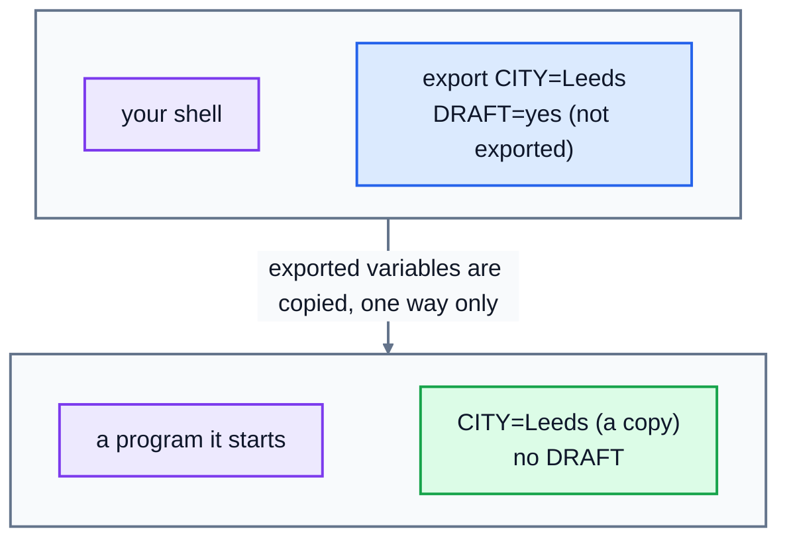

# 7. Environment variables

How does the shell know where your home folder is, which programs exist, or what language to show messages in? It looks at **environment variables**: named values that every program can read. They're also how you configure many tools, and how servers pass settings like database passwords to applications without writing them into the code.

## Variables in the shell

A variable has a name and a value. Read one by putting `$` in front of its name:

```
$ echo $HOME
/home/alex
$ echo "I am $USER and my shell is $SHELL"
I am alex and my shell is /bin/bash
```

Some you'll see often:

| Variable | Holds |
|---|---|
| `HOME` | your home folder; `~` is a shortcut for it |
| `USER` | your username |
| `SHELL` | your login shell |
| `PWD` | the folder you're in |
| `PATH` | the folders the shell searches for programs (below) |
| `LANG` | your language and character set, like `en_GB.UTF-8` |
| `EDITOR` | the text editor other programs should open (lesson 9) |

`printenv` (or `env`) lists every environment variable:

```
$ printenv | sort | head -n 4
HOME=/home/alex
LANG=en_GB.UTF-8
PATH=/usr/local/bin:/usr/bin:/bin:/usr/local/games:/usr/games
PWD=/tmp
```

### Setting variables

```
$ CITY=Leeds
$ echo $CITY
Leeds
```

**No spaces around the `=`.** `CITY = Leeds` means "run a command called CITY with the arguments = and Leeds", and fails with `CITY: command not found`. If the value has spaces, quote it: `GREETING="Hello there"`. By convention, environment variables have UPPER-CASE names.

### Quotes

- Inside **double quotes**, variables are expanded: `"$HOME"` becomes `/home/alex`.
- Inside **single quotes**, nothing is: `'$HOME'` stays as the text `$HOME`.

```
$ echo "$HOME" and '$HOME'
/home/alex and $HOME
```

It's a good habit to put double quotes round variables, `"$name"`, so a value with spaces stays together as one argument (lesson 2 showed what happens to names with spaces).

### Command output in a variable

`$(command)`, from lesson 4, works here too:

```
$ ls_count=$(ls / | wc -l)
$ echo "/ has $ls_count entries"
/ has 26 entries
```

## Exporting: passing variables to programs

A variable you set is only known to the **current shell**. Programs you start from it are separate processes, and they don't see it, unless you **export** it:

```
$ CITY=Leeds
$ bash -c 'echo "child sees: $CITY"'
child sees:
$ export CITY
$ bash -c 'echo "child sees: $CITY"'
child sees: Leeds
```

(`bash -c '...'` starts a new shell, a child process, to run one command.) You can set and export in one go: `export CITY=Leeds`. Exported variables are copied to every program started from this shell, and to programs those start, and so on. A child can't change its parent's variables, though: the copy only goes one way.

Only exported variables are copied into the new process, and the copy goes one way:



To give a variable to just one command, put it in front:

```
$ GREETING="Hello there" bash -c 'echo $GREETING'
Hello there
$ echo $GREETING

```

That's a common way to configure tools: `DEBUG=1 ./server`, `LANG=C sort names.txt`.

## PATH: where programs are found

When you type `ls`, how does the shell find the `ls` program? It looks through the folders listed in `PATH`, in order, separated by colons, and runs the first `ls` it finds:

```
$ echo $PATH
/usr/local/bin:/usr/bin:/bin:/usr/local/games:/usr/games
$ which ls python3
/usr/bin/ls
/usr/bin/python3
$ type cd
cd is a shell builtin
```

- `which` shows which file a command name runs. If a program isn't in any `PATH` folder, you get `command not found`, even if the file exists somewhere else on the disk.
- `type` also knows about things that aren't files: `cd` is built into the shell itself, because a separate program couldn't change the shell's own folder.

To make your own programs or scripts runnable by name, put them in a folder and add that folder to `PATH`:

```bash
export PATH="$PATH:$HOME/bin"
```

Notice `$PATH:` at the start: the new value is the old value plus one more folder. **Never** write `export PATH="$HOME/bin"` on its own: that throws away every other folder, and suddenly `ls`, `cat` and everything else is "not found" (until you open a new terminal).

## Aliases

An **alias** is a shortcut name for a longer command:

```bash
alias ll='ls -l'
alias gs='git status'
```

Type `alias` on its own to list the ones you have. Aliases only exist in the shell where you made them, and they're never exported.

## Making settings permanent: ~/.bashrc

Everything set at the prompt is forgotten when you close the terminal. To keep settings, put the same lines in your shell's start-up file, which runs every time you open a terminal:

- Bash: `~/.bashrc`
- Zsh (the default on macOS): `~/.zshrc`

```bash
# at the end of ~/.bashrc
export EDITOR=nano
export PATH="$PATH:$HOME/bin"
alias ll='ls -l'
```

Changes take effect in **new** terminals. To load them into the one you're in, run `source ~/.bashrc`. `source file` runs the file's commands in the **current** shell, rather than in a child, which is what makes its variables and aliases stick. A typo in `~/.bashrc` can break every new terminal, so keep a copy before you edit it.

## Keep secrets out of files you share

Applications often read passwords and keys from environment variables, like `DATABASE_PASSWORD`. That's better than writing them into the code, but be careful: don't put real secrets in files you commit to Git (the Git course explains `.gitignore` for exactly this), and remember that `printenv` shows them to anyone using your terminal.

## Practice: set up the bakery tools

Run the setup script, from the course folder:

```bash
bash 07-environment-variables/practice/setup.sh
```

The practice folder has a `bin` folder containing a small program, `bakery-hours`, and a nearly empty file called `env.sh`. Try running `bin/bakery-hours` first, to see what it needs.

Add three lines to `env.sh`:

1. Set `BAKERY_CITY` to `Leeds`, exported so that programs can see it.
2. Add the practice folder's `bin` folder to the end of `PATH`, keeping everything already in it. Use the full path of the folder (run `pwd` to see it), or `$HOME/practice/linux-command-line/07-environment-variables/bin`.
3. Define the alias `ll` for `ls -l`.

Then run `source env.sh`, and check that typing just `bakery-hours` prints `Open 7am to 3pm in Leeds`.

In `answers.txt`, write:

1. The path of your home folder.
2. Your login shell.
3. The full path of the `ls` program.

Then run `check.sh`, as `setup.sh` showed you. It loads your `env.sh` in a fresh, clean shell, the way a new terminal would.

<details>
<summary>Hints</summary>

- The three lines are `export BAKERY_CITY=Leeds`, `export PATH="$PATH:/the/full/path/bin"` and `alias ll='ls -l'`. Edit the file with `nano env.sh`, or add lines with `echo '...' >> env.sh`.
- Answers: `echo $HOME`, `echo $SHELL`, and `which ls`.

</details>

The answers are in [solutions/07-environment-variables.md](../solutions/07-environment-variables.md).

## Recap

- Read a variable with `$NAME`. Set one with `NAME=value`, with no spaces round `=`.
- `export` passes a variable on to programs you start. `NAME=value command` sets it for one command.
- `PATH` lists the folders searched for programs. Add to it with `PATH="$PATH:/new/folder"`.
- Aliases are shortcuts. Put settings in `~/.bashrc` or `~/.zshrc` to keep them; `source` loads a file into the current shell.

Next: [8. Shell scripting](../08-shell-scripting/)
