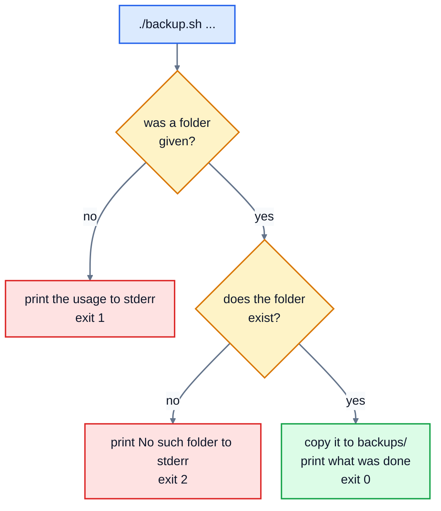

# 8. Shell scripting

Once you've typed the same five commands three times, it's time to write them down. A **shell script** is a text file of commands that the shell runs in order. Scripts do everyday jobs: backups, setting up a new computer, deploying a website, tidying logs. And you already know most of what goes in them, because a script is just the commands from lessons 1 to 7, plus a few ways to make decisions and repeat things.

## A first script

```bash
#!/usr/bin/env bash
# greet.sh: say hello to everyone named on the command line
echo "This script is called $0 and got $# arguments"
for name in "$@"; do
  echo "Hello, $name!"
done
```

```
$ chmod +x greet.sh
$ ./greet.sh Sam Priya "Ella Brooks"
This script is called ./greet.sh and got 3 arguments
Hello, Sam!
Hello, Priya!
Hello, Ella Brooks!
```

- The first line, the **shebang** (`#!`), says which program runs the script. `#!/usr/bin/env bash` means "find bash on the PATH and use it", which works on Linux and macOS.
- Lines starting with `#` are **comments**: notes for people, ignored by the shell.
- `chmod +x` makes it runnable (lesson 5), and `./` runs it from the current folder. `bash greet.sh` also works, without the `chmod`.

## Arguments

| Variable | Holds |
|---|---|
| `$1`, `$2`, ... | the first, second, ... argument |
| `$#` | how many arguments there are |
| `"$@"` | all the arguments, each kept separate (so "Ella Brooks" stays one name) |
| `$0` | the script's own name |
| `$?` | the exit code of the last command (lesson 6) |

Copy arguments into variables with meaningful names near the top: `folder="$1"`. And always put double quotes round variables, `"$folder"`, or a name with a space in it will be split in two.

## Making decisions: if

```bash
if [ "$#" -eq 0 ]; then
  echo "Usage: ./backup.sh FOLDER" >&2
  exit 1
fi
```

`if` runs a command, and checks its exit code: 0 (success) counts as true. `[ ... ]` is a command for testing things, and it **needs spaces inside the brackets**: `[ "$#" -eq 0 ]`, not `["$#" -eq 0]`.

| Test | True when |
|---|---|
| `[ -f path ]` | it's a file that exists |
| `[ -d path ]` | it's a directory that exists |
| `[ -e path ]` | anything exists there |
| `[ -z "$text" ]` | the text is empty |
| `[ "$a" = "$b" ]` | the two texts are the same (`!=` for different) |
| `[ "$n" -eq 5 ]` | the numbers are equal. Also `-ne`, `-lt` (less than), `-le`, `-gt`, `-ge`. |
| `[ ! ... ]` | the test is **not** true |

Numbers use letters (`-lt`), not `<`, because `<` already means "read input from a file". There's also `elif` ("else if") and `else`:

```bash
if [ "$count" -eq 0 ]; then
  echo "OUT: $item"
elif [ "$count" -lt 5 ]; then
  echo "low: $item ($count left)"
else
  echo "fine: $item"
fi
```

Any command can go after `if`, not just `[`: `if grep -q error app.log; then ...` runs the branch when `grep` finds something.

## Repeating: for and while

`for` repeats for each item in a list:

```bash
for file in *.csv; do
  echo "Processing $file"
done
```

`while` repeats as long as a command succeeds. The most useful form reads a file line by line:

```bash
while IFS=, read -r item count; do
  ...
done < stock.csv
```

Here's that pattern in a complete script, on a file of stock levels:

```
$ cat stock.csv
flour,12
butter,3
yeast,0
sugar,8
$ ./stock.sh
low: butter (3 left)
OUT: yeast
```

`IFS=,` makes `read` split each line at commas, and `read -r item count` puts the first part in `item` and the rest in `count`. The `< stock.csv` after `done` feeds the file into the loop.

## Arithmetic

The shell treats everything as text, so to calculate, use `$(( ... ))`:

```
$ x=5; echo $((x * 3 + 1))
16
```

It only does whole numbers. For decimals, scripts usually call another tool, like `awk` or `python3`.

## Functions

A **function** names a group of commands, so you can use them several times:

```bash
count_lines() {
  local file="$1"
  wc -l < "$file" | tr -d ' '
}

for file in *.csv *.sh; do
  echo "$file has $(count_lines "$file") lines"
done
```

Inside a function, `$1` and the others are the function's own arguments. `local` keeps a variable inside the function, so it can't clash with one elsewhere in the script.

## Exit codes and errors

A script's exit code is the exit code of its last command, or whatever you give `exit`. Follow the convention: `exit 0` for success, and other numbers for different problems. Send error messages to standard error with `>&2`, so they still show on screen when someone saves the output to a file.

By default, a script carries on after a command fails, which can be dangerous: if `cd backups` fails, the `rm -rf *` on the next line runs in the wrong folder. Many scripts start with:

```bash
set -euo pipefail
```

- `-e`: stop as soon as a command fails.
- `-u`: stop if you use a variable that was never set (catches typos).
- `-o pipefail`: a pipeline fails if any part of it fails, not just the last.

They have surprises of their own (for example, `grep` finding nothing counts as a failure), but for most small scripts they make mistakes stop the script instead of causing damage.

### Checking scripts with ShellCheck

[ShellCheck](https://www.shellcheck.net/) finds common bugs in shell scripts, like missing quotes. Paste a script into the website, or install it (`sudo apt install shellcheck`, `brew install shellcheck`) and run `shellcheck backup.sh`. It's worth using on every script you write.

## Practice: a backup script

Run the setup script, from the course folder:

```bash
bash 08-shell-scripting/practice/setup.sh
```

The practice folder has a `recipes` folder (3 files, one of them in a folder inside it) and a `backup.sh` with just a shebang and a comment. Finish `backup.sh` so that:

1. `./backup.sh recipes` copies the whole `recipes` folder to `backups/recipes-YYYY-MM-DD`, with today's date, making `backups` if it doesn't exist. Then it prints exactly `Backed up 3 files from recipes to backups/recipes-2026-03-14` (with the right number of files, folder and date), and exits with 0.
2. `./backup.sh` with no folder prints `Usage: ./backup.sh FOLDER` to standard error, and exits with 1.
3. `./backup.sh no-such-folder` prints `No such folder: no-such-folder` to standard error, makes no backup, and exits with 2.

The script checks for problems first, and only then does the work:



Make it executable, try all three, then run `check.sh`, as `setup.sh` showed you. The check runs your script in a scratch copy of the folder, so it doesn't matter how many backups you've already made.

<details>
<summary>Hints</summary>

- The order: check `$#`, then put `$1` in a variable, then check the folder exists with `[ ! -d "$folder" ]`, then do the backup.
- Today's date: `today=$(date +%F)`. Copy with `cp -r "$folder" "backups/$folder-$today"`.
- Count files with `find "$folder" -type f | wc -l`. On a Mac, `wc` adds spaces before the number; `| tr -d ' '` removes them.
- Test the exit codes with `./backup.sh; echo $?`.

</details>

The answers are in [solutions/08-shell-scripting.md](../solutions/08-shell-scripting.md).

## Recap

- A script starts with `#!/usr/bin/env bash`, is made executable with `chmod +x`, and runs with `./script.sh`.
- `$1`, `$#` and `"$@"` hold the arguments. Quote your variables.
- `if [ test ]; then ... fi` decides; `for` and `while read` repeat; `$(( ))` does arithmetic; functions group commands.
- Exit with 0 for success and another number for errors, and send error messages to `>&2`. `set -euo pipefail` stops a script at the first failure.

Next: [9. Text editors](../09-text-editors/)
