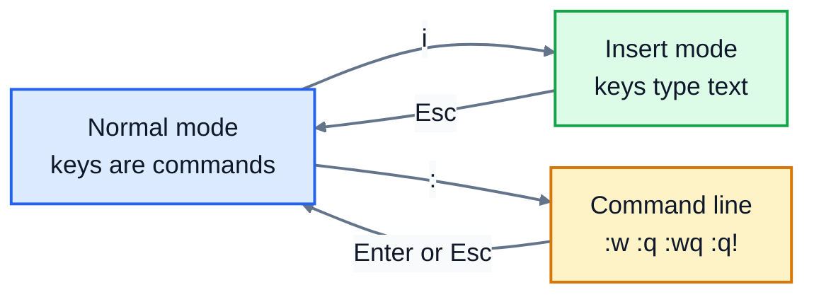

# 9. Text editors

On your own computer you can edit files in VS Code or any app you like. But when you connect to a server, all you get is a terminal, and the settings file you need to change is `/etc/something.conf`. So everyone who works with Linux needs at least one **terminal text editor**. This lesson covers the two you'll find almost everywhere: **nano**, which is easy, and **vim**, which is powerful and, famously, hard to quit.

## nano: the friendly one

```bash
nano notes.txt
```

nano opens the file (or a new, empty one) and you can type straight away. Move with the arrow keys. The bottom two lines of the screen list the main shortcuts, where `^` means the Ctrl key: `^O Write Out` is Ctrl+O.

| Keys | Does |
|---|---|
| **Ctrl+O**, then Enter | save ("write out") |
| **Ctrl+X** | quit. If there are unsaved changes, nano asks: press `Y` to save, `N` to throw them away. |
| **Ctrl+K** | cut the current line |
| **Ctrl+U** | paste the line you cut |
| **Ctrl+W** | search ("where is") |
| **Ctrl+\\** | search and replace |
| **Ctrl+G** | help |

On macOS, nano might be replaced by a similar program called pico, or missing. The keys are the same. If you're not sure which editor to use, use nano.

## vim: the powerful one

vim (and its ancestor, vi) is on nearly every Unix system ever made, including tiny ones where nothing else is installed. Even if you never choose it, you will one day end up in it by accident (Git opens it for commit messages unless told otherwise), so you need to know how to get out.

vim has **modes**. That's the thing that confuses everyone at first:



- vim starts in **normal mode**, where every key is a command: `x` deletes a character, `dd` deletes a line. Typing a word here does strange things.
- Press `i` to enter **insert mode**. Now keys type text, like any editor. vim shows `-- INSERT --` at the bottom.
- Press **Esc** to go back to normal mode.
- In normal mode, `:` starts a command at the bottom of the screen.

### Getting out of vim

Press **Esc** (twice, to be sure), then type one of these and press Enter:

| Command | Does |
|---|---|
| `:wq` | save and quit |
| `:q` | quit (only works if there are no unsaved changes) |
| `:q!` | quit and **throw away** the changes |
| `:w` | save, and keep editing |

### A few more vim commands

All in normal mode:

| Keys | Does |
|---|---|
| `h` `j` `k` `l`, or the arrow keys | move left, down, up, right |
| `gg`, `G` | go to the first line, the last line |
| `/word`, then Enter | search; `n` for the next match |
| `i`, `a` | insert before the cursor, after it |
| `o` | open a new line below and start typing |
| `x` | delete the character under the cursor |
| `dd` | delete (cut) the line |
| `yy`, `p` | copy ("yank") the line, paste it below |
| `u` | undo; Ctrl+R to redo |

People who learn vim properly can edit remarkably fast, without touching the mouse. If you'd like to try, run `vimtutor`, a 30-minute interactive lesson that comes with vim.

## Choosing your editor

Programs that open an editor for you, like `git commit` or `crontab -e`, use the `EDITOR` environment variable (lesson 7). To make that nano, add this to `~/.bashrc` (or `~/.zshrc`):

```bash
export EDITOR=nano
```

Other good choices: **micro** (like nano, with mouse support and familiar keys like Ctrl+S), and **emacs**. And for remote servers, VS Code's "Remote - SSH" extension lets you edit files on a server with your normal editor.

### Editing files you don't own

System settings files belong to root, so open them with `sudo`: `sudo nano /etc/hosts`. Make a copy first, in case you need to undo your change: `sudo cp /etc/hosts /etc/hosts.backup`.

### The final new line

Text files on Linux end with a new-line character after the last line. Some tools behave oddly without it: `wc -l` doesn't count the last line, and `cat` puts your prompt on the end of it. nano and vim add it for you when you save.

## Practice: edit a settings file

Run the setup script, from the course folder:

```bash
bash 09-text-editors/practice/setup.sh
```

The practice folder has `bakery.conf`, the settings for a bakery's ordering website. Using nano or vim (your choice, but try both if you're curious):

1. Change the opening time from `open=08:00` to `open=07:00`.
2. Delete the whole `debug=true` line.
3. Add a new last line: `city=Leeds`.
4. Leave the other lines as they are, and save.
5. Create a new file called `notes.txt`, type three lines in it, and save it.

Then run `check.sh`, as `setup.sh` showed you.

<details>
<summary>Hints</summary>

- nano: arrow keys to move, Ctrl+K deletes the current line, Ctrl+O then Enter saves, Ctrl+X quits.
- vim: `i` to type, Esc to stop typing, `dd` deletes a line, `G` then `o` adds a line at the end, `:wq` saves and quits.
- Stuck in vim? Esc, then `:q!` and Enter gets you out without saving, and you can start again.

</details>

The answers are in [solutions/09-text-editors.md](../solutions/09-text-editors.md).

## Recap

- **nano**: just type. Ctrl+O saves, Ctrl+X quits, Ctrl+K cuts a line.
- **vim** has modes: `i` to type, Esc to stop, then `:wq` to save and quit or `:q!` to quit without saving.
- Set `EDITOR` to the editor you want other programs to open.
- Use `sudo` to edit system files, and back them up first.

Next: [10. Package managers](../10-package-managers/)
