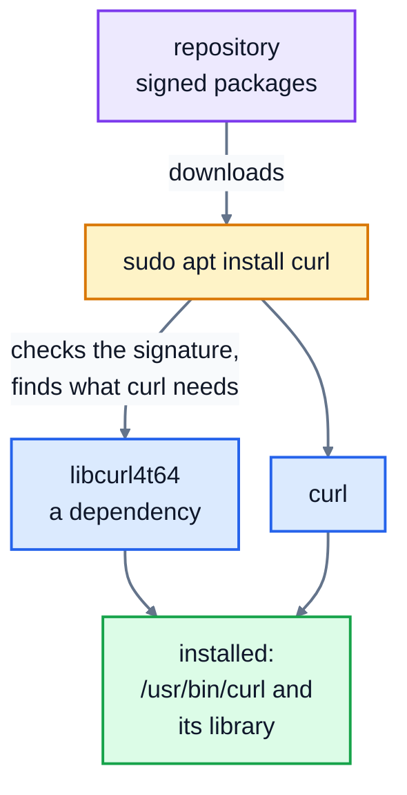

# 10. Package managers

On Windows you might install a program by downloading a file from a website and clicking through an installer. On Linux, you usually type one command, and a **package manager** fetches the program from a trusted source, installs it along with everything it needs, and keeps it up to date afterwards. macOS has an excellent one too, and Windows now has its own.

This lesson has no practice lab, because installing software needs admin rights on your computer. Try the commands on your own machine if you're comfortable, or just read along.

## Packages and repositories

- A **package** is a program (or a library) bundled with information about it: its version, a description, and which other packages it **depends** on.
- A **repository** is a server full of packages, run by your Linux distribution (Debian, Ubuntu, Fedora and so on). Every package is checked and digitally **signed**, and the package manager refuses ones whose signatures don't match, so you know they haven't been tampered with on the way.
- The **package manager** is the tool that searches the repositories, downloads packages, installs them in the right places, and removes them cleanly.

Because the package manager knows about everything installed, one command can update every program on the system at once, including security fixes.

Installing one program, step by step:



## Which package manager?

It depends on the system:

| System | Package manager | Install a program |
|---|---|---|
| Debian, Ubuntu, Linux Mint, Raspberry Pi OS, WSL's Ubuntu | `apt` | `sudo apt install tree` |
| Fedora, Red Hat, Rocky Linux | `dnf` | `sudo dnf install tree` |
| Arch Linux | `pacman` | `sudo pacman -S tree` |
| Alpine (common in Docker containers) | `apk` | `apk add tree` |
| macOS | **Homebrew** (`brew`), installed from [brew.sh](https://brew.sh/) | `brew install tree` |
| Windows | `winget` | `winget install ...` |

The rest of this lesson uses `apt`, the most common one. The others work in the same way, with different words.

## Using apt

### Update the list, then upgrade

```bash
sudo apt update
sudo apt upgrade
```

These two are easy to confuse:

- `apt update` downloads the **latest list** of what's available from the repositories. It doesn't change any of your programs.
- `apt upgrade` installs newer versions of the programs you already have.

Run `update` first, so `upgrade` knows what's new. Both need `sudo` (lesson 5), because they change the system for every user.

### Find, look, install, remove

| Command | Does |
|---|---|
| `apt search word` | search package names and descriptions |
| `apt show name` | details of one package |
| `sudo apt install name` | install it, and anything it depends on |
| `sudo apt remove name` | uninstall it (keeping its settings files) |
| `sudo apt purge name` | uninstall it and its settings |
| `sudo apt autoremove` | remove dependencies that nothing needs any more |
| `apt list --installed` | list everything that's installed |

Here's real output from `apt show` on a Debian-based system:

```
$ apt show curl
Package: curl
Version: 8.22.0-1
Priority: optional
Section: web
Maintainer: Debian Curl Maintainers <team+curl@tracker.debian.org>
Installed-Size: 532 kB
Depends: libcurl4t64 (= 8.22.0-1), libc6 (>= 2.43), zlib1g (>= 1:1.1.4)
Recommends: bash-completion
Homepage: https://curl.se/
...
```

The `Depends` line is the point of a package manager: install `curl`, and `apt` installs the `libcurl4t64` library it needs, if you don't have it already. Over 3,000 packages were installed on that system. Nobody could track their dependencies by hand.

To see where a package's files went, ask the lower-level tool `apt` is built on, `dpkg`:

```
$ dpkg -L curl | head -n 4
/.
/usr
/usr/bin
/usr/bin/curl
```

Programs go in `/usr/bin`, which is on everyone's `PATH` (lesson 7), so `curl` works straight away.

## Other ways to install software

- **Language package managers**: Python has `pip`, JavaScript has `npm`, Rust has `cargo`, and so on. They install libraries for one language, often for one project at a time. Use them for your code's libraries, and the system package manager for programs. Mixing them up (like `sudo pip install` into the system's Python) can break tools your system relies on; that's why modern Linux systems refuse to let `pip` change the system Python, and suggest a virtual environment instead.
- **Snap and Flatpak** package desktop apps with everything they need included, so the same package works on any Linux system.
- **Downloading a script and running it**, like `curl https://example.com/install.sh | bash`. Some projects really do install this way, but it runs whatever the server sends, with your permissions. Only do it for sources you trust, and ideally download the script and read it first.

## Keeping a system safe

On any computer that's connected to the internet, installing updates is the single most important security habit. Most attacks use security holes that were fixed months earlier, on computers that were never updated. On a server, run `sudo apt update && sudo apt upgrade` regularly, or turn on automatic security updates (on Ubuntu, the `unattended-upgrades` package does this).

## Recap

- A package manager installs programs from trusted, signed repositories, along with their dependencies.
- Debian and Ubuntu use `apt`, Fedora uses `dnf`, macOS has Homebrew (`brew`).
- `apt update` refreshes the list; `apt upgrade` installs the updates. `apt install`, `apt remove` and `apt search` do what they say.
- Use language tools like `pip` for project libraries, and keep your system updated.

Next: [11. Project: a log report](../11-project-log-report/)
